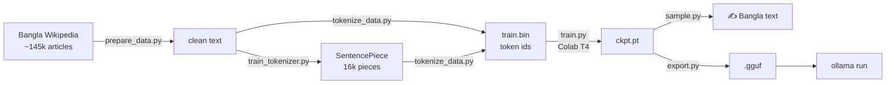

# 🇧🇩 Bangla Mini-GPT

A Bangla language model **built from scratch**: our own tokenizer, our own transformer, trained on Bangla Wikipedia, and run in **Ollama**.



## Model sizes

| size | params | where | time |
|---|---|---|---|
| `tiny` | 2.9M | your CPU | ~15 min (pipeline check) |
| `small` | 16.8M | Colab T4 | ~40 min |
| `base` | 49.0M | Colab T4 | ~2–3 h (resumes across sessions) |

Llama shape: RMSNorm · RoPE · SwiGLU · tied embeddings. The module names match Hugging Face `LlamaForCausalLM`, and a test proves both give identical outputs. That's why export to Ollama works.

## Run locally (CPU)

```powershell
.\.venv\Scripts\Activate.ps1
python prepare_data.py --shards 1 --max-docs 4000
python train_tokenizer.py
python tokenize_data.py
python train.py --size tiny
python sample.py --size tiny --prompt "বাংলাদেশ"
python export.py --size tiny --ollama
ollama run bangla-mini-gpt-tiny "বাংলাদেশ"
```

## Playground website

```powershell
python app.py      # -> http://127.0.0.1:8000
```
✍ Write (streaming, sliders, compare models) · 🔤 Tokens · 📈 Training curve + samples · 🧠 Model diagram.
It picks up every `out/<size>/ckpt.pt`. To test the Colab model, put its `ckpt.pt` in `out/base/`.

## Train the real one (Colab)

1. `python pack_for_colab.py` → upload `bangla-mini-gpt-code.zip` to **My Drive/bangla-mini-gpt/**
2. Open [colab/train_on_colab.ipynb](colab/train_on_colab.ipynb) in Colab → T4 GPU → Run all
3. Download **My Drive/bangla-mini-gpt/export/base/** → `ollama create bangla-mini-gpt-base -f Modelfile`

## Files

| file | what it teaches |
|---|---|
| [minigpt/model.py](minigpt/model.py) | attention, RoPE, RMSNorm, SwiGLU, sampling |
| [train_tokenizer.py](train_tokenizer.py) | BPE: how text becomes numbers |
| [train.py](train.py) | the training loop: loss, AdamW, warm-up + cosine LR, mixed precision |
| [export.py](export.py) | weight mapping → Hugging Face → GGUF → Ollama |
| [tests/test_model.py](tests/test_model.py) | causality, overfit-one-batch, Llama parity |

## What to expect

It's a **base model**. It continues text in Wikipedia style and doesn't chat or follow instructions; that needs a second stage (instruction fine-tuning). Facts will often be wrong, because 49M parameters is roughly 1/30 the size of qwen3:1.7b.

Built by Atiqul Islam Chowdhury.
